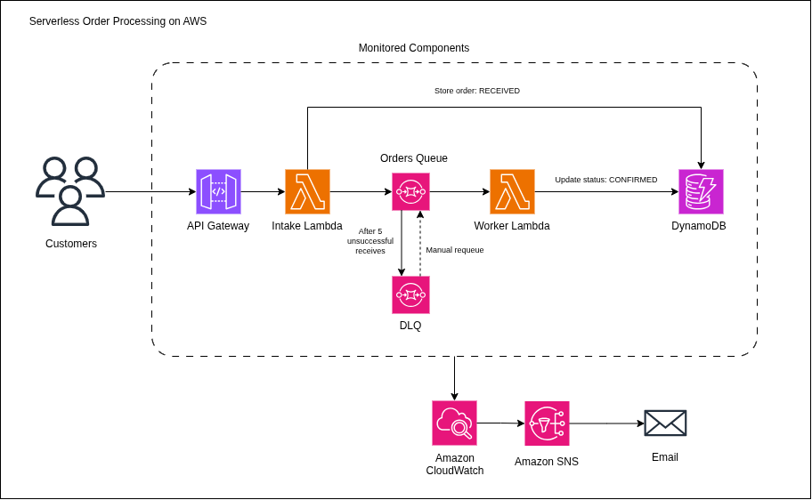

# Serverless Order Processing on AWS

An event-driven order intake pipeline built for flash-sale traffic: an API that accepts orders at high request rates, stores them durably, and processes them asynchronously, with idempotency, a dead-letter queue, and an alarm and dashboard design.

Intake returns as soon as the order is stored and queued; it never waits for processing. The design assumes messages can arrive twice and that the worker can fail mid-batch, and handles both.

## Architecture



This is the architecture as built. The API, both functions, both queues, the table, the queue trigger, the SNS alert topic with a confirmed email subscription, five CloudWatch alarms and the dashboard are all confirmed in the AWS console. See Verification status.

| Component | Service | Role |
|---|---|---|
| `POST /orders` | API Gateway (REST API) | Front door. API key + usage plan throttles traffic before it reaches code. |
| `orders-intake` | Lambda (Python 3.12) | Validates the order, stores it as `RECEIVED`, queues it, returns 202. |
| `OrdersQueue` | SQS (Standard) | Buffers orders so processing scales independently of intake. |
| `OrdersDLQ` | SQS (Standard) | Captures messages that fail 5 receive attempts. |
| `orders-worker` | Lambda (Python 3.12) | Confirms or rejects each order with one conditional DynamoDB update. |
| `OrdersTable` | DynamoDB (on-demand) | Single source of truth for order state; 30-day TTL in the design (TTL setting not verified in the console). |
| Alarms + dashboard | CloudWatch | Queue depth, backlog age, DLQ, worker failures, intake errors. |
| Alert topic | SNS | Emails alarm state changes. |

## How an order flows

As implemented in `src/`. The deployed code of both functions was compared with these files on 24 Nov 2026 and matches after normalizing trailing whitespace (a visual read of the console editor, not a byte-level hash comparison).

1. The client POSTs an order with an `Idempotency-Key` header.
2. Intake validates the payload against a fixed catalog (SKU and quantity rules) and derives the order ID as a hash of the idempotency key.
3. Intake writes the order to DynamoDB with a conditional put (`attribute_not_exists(orderId)`), so a retry can never create a second record for the same key.
4. Intake sends the order ID to SQS and returns `202 Accepted` only after both steps succeed.
5. The worker picks up batches (template setting: up to 10 messages; the deployed trigger's batch size was not verified) and moves each order from `RECEIVED` to `CONFIRMED` (with total and confirmation time) or `REJECTED`, using a conditional update that only fires on `RECEIVED`.
6. A message that keeps failing lands in the DLQ after 5 receives (verified on the queue). This triggers the `orders-dlq-not-empty` alarm (it exists and is OK; it has not fired in practice). It can be redriven after the underlying problem is fixed.

### Response codes

| Code | Meaning |
|---|---|
| `202` | Order stored and queued. Body carries `orderId` and status `RECEIVED`. |
| `200` | Same idempotency key arrived after the order was already processed; returns the current status. |
| `400` | Invalid body, or a missing/malformed `Idempotency-Key` header. |
| `409` | Same idempotency key used with a different order payload. |
| `413` | Body over 16 KB. |
| `503` | Stored but could not be queued; the client retries with the same key and the retry re-queues it. |

```bash
curl -X POST "https://YOUR_API_ID.execute-api.us-east-1.amazonaws.com/YOUR_STAGE/orders" \
  -H "x-api-key: YOUR_API_KEY" \
  -H "Idempotency-Key: order-12345-abcdef" \
  -H "Content-Type: application/json" \
  -d '{"customerId":"cust-1","items":[{"sku":"MUG-CER","qty":2}]}'
```

## Design decisions

These decisions are implemented in the authored source and `template.yaml`. The Verification status table marks what is also confirmed in the live account.

- **Store first, then queue.** Intake writes to DynamoDB before sending to SQS, so a queued message always points at a stored order. The two calls are not atomic: if the send fails, the client gets a 503 and retries with the same key; the retry finds the stored `RECEIVED` order and queues it again without creating a duplicate.
- **Idempotency by construction.** The order ID is derived from the client's idempotency key, the put is conditional, and the stored request hash is compared on retry. Same key, same payload: safe retry. Same key, different payload: `409`.
- **Standard SQS, at-least-once.** Confirmation does not need strict ordering, and a standard queue is the simpler fit. Duplicates are expected, so the worker's only side effect is a conditional update that moves `RECEIVED` to a final state. A repeated delivery finds a final status and does nothing.
- **Partial batch responses.** The worker returns only the failed message IDs (`batchItemFailures`), so one bad message does not force the other 9 in its batch to retry.
- **Queue settings tied to the worker.** Visibility timeout is 90 s, six times the 15 s worker timeout, and `maxReceiveCount` is 5, following the Lambda SQS guidance. The test suite fails if one changes without the other.
- **Capped worker concurrency.** The template sets the event source mapping to 5 concurrent invocations (deployed value not verified) so backlog is visible under modest demo traffic. Raise it for real use.
- **Fault switch in DynamoDB.** A single control item (`CONTROL#fault` with an expiry) makes the worker slow or fail on demand, which makes failure experiments safe to run and self-ending. No extra service needed.
- **Metrics from log lines.** Both functions emit CloudWatch Embedded Metric Format lines, so custom metrics need no extra API calls or IAM permissions.

## Monitoring

Created manually in the console and CLI with `orders-*` names; `template.yaml` is the SAM equivalent of the same design (with stack-prefixed names). Custom metrics in namespace `FlashOrders` come from log lines (orders accepted, duplicates, rejected at intake, confirmed, message failures, confirm latency). Seven of the eight exist today; `OrdersRejectedAtIntake` appears after the first rejected request.

Five alarms publish ALARM and OK changes to the SNS topic `orders-alerts` (one confirmed email subscription):

- `orders-dlq-not-empty`: DLQ has 1 or more visible messages
- `orders-backlog-age`: oldest message at least 120 s, 2 periods
- `orders-backlog-depth`: queue depth at least 300, 2 periods
- `orders-worker-failures`: worker message failures, 2 of 3 periods
- `orders-intake-errors`: API Gateway 5XX + Lambda errors (metric math), at least 5

The nine-widget dashboard `orders` shows intake, queue, worker outcomes, latency, DLQ, API Gateway and alarm status. All five alarms are currently OK. They have not fired, and email delivery of an alarm has not been tested.

## Testing

The suite runs fully offline with moto (fake DynamoDB and SQS) and expands the SAM template locally, covering intake and worker logic, the redrive tooling, and that the template, IAM and alarms agree with the code:

```bash
python3 -m venv .venv && . .venv/bin/activate
pip install -r requirements-dev.txt
python -m pytest -q    # 40 passed
```

40 tests passing, re-run on 24 Nov 2026. Offline tests prove the logic of the authored source in this repository, not the deployed code or real AWS timing and throttling; the load and failure experiments below exist for that.

## Load and failure experiments

`tools/loadgen.py` generates traffic (with a deliberate 5% of repeated idempotency keys) and `tools/ops.py` operates the system: `status`, `fault slow|fail|off`, `dlq`, `redrive`, `verify`, `stuck`, `requeue`, `inject-poison`.

- **Baseline**: 20 rps for 60 s. Watch the queue drain and check that every accepted order reaches `CONFIRMED`.
- **Slow worker**: the fault switch adds 800 ms per message at 40 rps. Watch the backlog grow and the backlog-age alarm fire while intake keeps returning 202.
- **Broken worker**: every call fails for 10 minutes. Orders stay safe as `RECEIVED`, messages move to the DLQ and the DLQ alarm fires.
- **Recovery**: redrive the DLQ and verify nothing was lost. The redrive validates each message first, so a poison message cannot silently bounce forever.

## Deployment

The system was built manually in the AWS console in `us-east-1`. `template.yaml` is the same design as infrastructure as code (SAM), so an equivalent stack can be deployed with `sam deploy --guided`. Note that this creates new, separate resources with their own names and charges; it does not adopt or update the manually created ones. The template needs one parameter: an email address for alarm notifications.

## Verification status

Honest about what is confirmed in the live account versus what is design or earlier evidence:

| Item | Status |
|---|---|
| DynamoDB table, SQS queues with DLQ policy (5 receives), both Lambda functions, REST API `orders-api` | Verified in the console, see [docs/console-evidence.md](docs/console-evidence.md) |
| API stage `prod`, `POST /orders` with API key required, Lambda proxy integration to `orders-intake` | Verified in the console |
| Both functions: Python 3.12, arm64, 256 MB, timeouts 10 s (intake) and 15 s (worker), queue visibility timeout 90 s | Verified, matches `template.yaml` |
| `OrdersQueue` triggers `orders-worker` | Verified: one enabled Lambda trigger on the queue |
| Worker trigger batch size 10, concurrency 5, partial batch responses | Not verified (defined in `template.yaml`) |
| Deployed code identical to `src/` (`intake.py`, `worker.py`, `common.py` in both functions) | Matches after trailing-whitespace normalization, 24 Nov 2026 (not a byte-level hash comparison) |
| CloudWatch dashboard `orders` (9 widgets) | Verified in the console |
| SNS topic `orders-alerts`, email subscription Confirmed | Verified in the console |
| Five CloudWatch alarms, all OK, actions enabled, publishing to `orders-alerts` | Verified in the console; never fired, delivery not tested |
| Seven of eight `FlashOrders` metrics | Verified; `OrdersRejectedAtIntake` appears after the first rejected request |
| Usage plan values, log contents | Not verified (stage rate 10000, burst 5000 verified) |
| One stored order in end state (`CONFIRMED`, total 2598 cents, confirmed 3.9 s after creation) | Historical record from an earlier run, not re-tested during documentation |

## Repository structure

```
.
├── template.yaml          # SAM template: full stack, IAM, alarms, dashboard
├── requirements-dev.txt   # test dependencies
├── src/
│   ├── intake.py          # API handler: validate, store, enqueue
│   ├── worker.py          # SQS consumer: conditional confirm/reject
│   └── common.py          # validation, catalog, EMF metrics, helpers
├── tools/
│   ├── loadgen.py         # traffic generator (stdlib only)
│   └── ops.py             # status, fault switch, DLQ, redrive, verify
├── tests/                 # 40 tests, run offline with moto
├── docs/
│   └── console-evidence.md
└── images/
```

## Limitations and next steps

- Store-then-queue is not atomic: an order can be stored but never queued if the client never retries a failed send. Today this is found with `ops.py stuck` and fixed with `ops.py requeue`; a DynamoDB Streams outbox or a scheduled sweeper would close the gap.
- The API key and usage plan throttle and meter one demo key. They are not authentication or authorization. A real store would put Cognito or IAM auth in front.
- In the design, orders expire after about 30 days (DynamoDB TTL), which also ends the idempotency window. TTL deletion is a background process and is not exact to the second, and the TTL setting was not verified in the console.
- `ops.py stuck` uses a table scan: fine at demo size, not at production volume.
- Payments, real inventory, user accounts and a storefront are out of scope on purpose.

## Cost and cleanup

Everything is serverless and mostly pay-per-use, but monitoring carries a standing charge. As an estimate only (not a bill or a cap), the baseline is about $5.70 per month before tax: 5 alarms, 1 dashboard and the custom metrics, plus log ingestion and SNS email, which depend on usage. Free-tier allowances may offset part of it. Check current AWS pricing for your region. To stop charges from this project, delete the resources it created: the stack (if you deployed the template), or the manually created table, queues, functions, API, alarms, dashboard and log groups. Then check for retained log groups, backups, deployment artifacts and any other stacks or resources in the account that may still incur charges. This is a checklist, not a guarantee that nothing is left.
