# Console evidence

Screenshots from the AWS console (`us-east-1`), taken 24 Nov 2026. They show which parts of the system exist and how they are configured. Screenshots show configuration, not behavior: nothing below proves a code path ran. The account ID and the alert email address are blacked out.

## 1. DynamoDB table overview

`OrdersTable`: on-demand capacity, status Active, partition key `orderId`, item count 1, no active alarms, point-in-time recovery off.

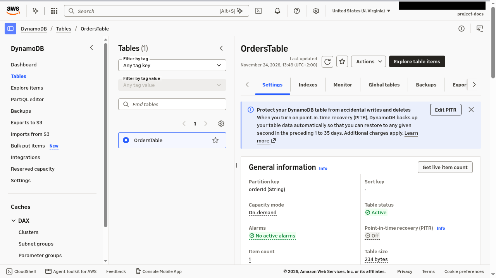

## 2. Stored order item (historical record)

The table holds one item with `status` `CONFIRMED`, `totalCents` 2598, one line item (`MUG-CER`, quantity 2), and `confirmedAt` 3882 ms after `createdAt`. This is the end state of one earlier order. It was not created or re-tested while producing this document, and it does not show how the order was submitted or whether a retry was made.

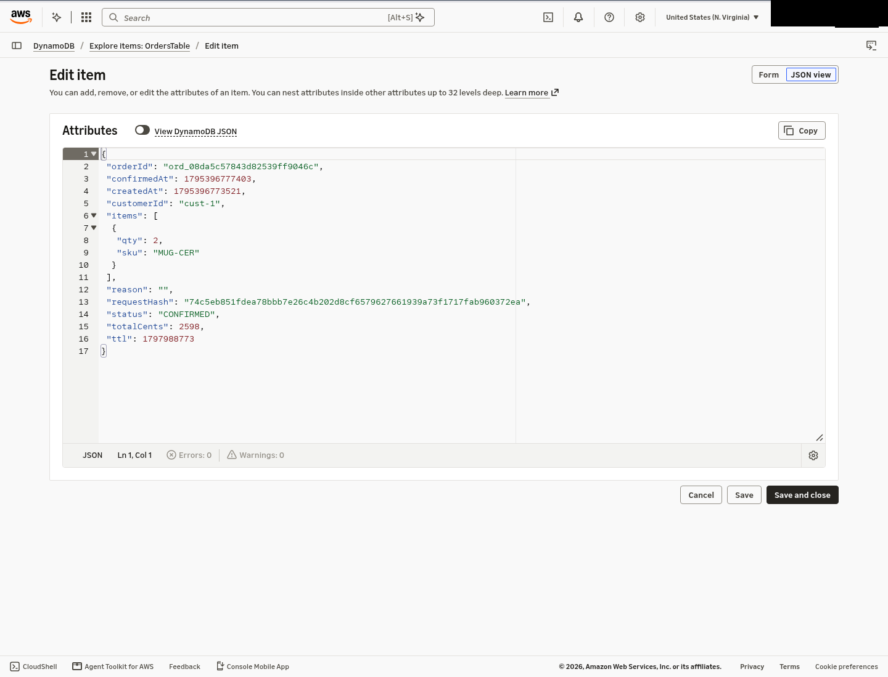

## 3. Lambda functions

`orders-worker` and `orders-intake` exist, both Python 3.12, Zip package.

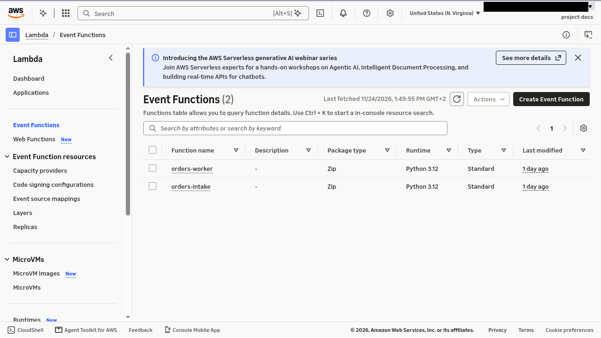

## 4. SQS queues

`OrdersQueue` and `OrdersDLQ` exist, both Standard with SSE-SQS encryption, 0 messages available and 0 in flight at capture time.

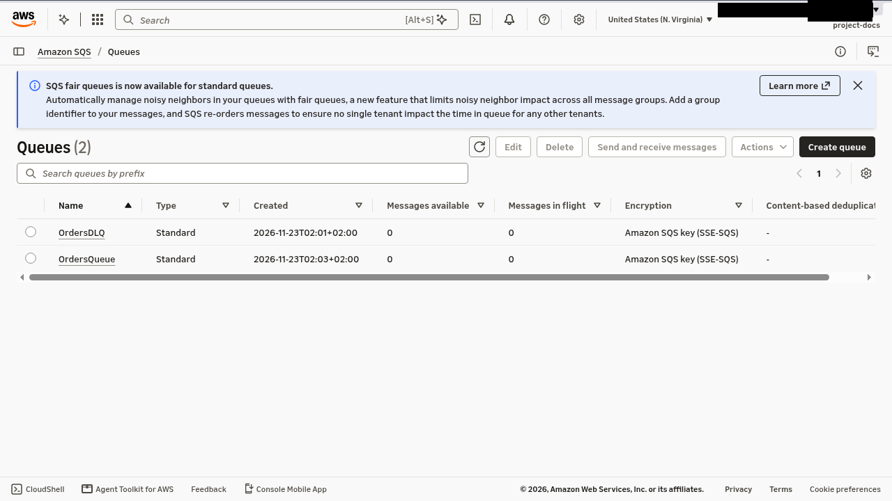

## 5. API Gateway

REST API `orders-api`, Regional endpoint.

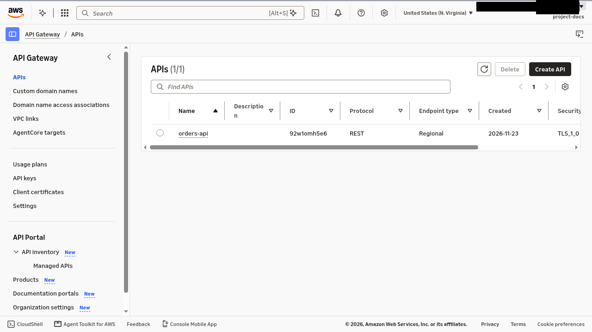

## 6. `POST /orders` method

The method execution diagram shows Client, method request, integration request, Lambda integration and proxy integration.

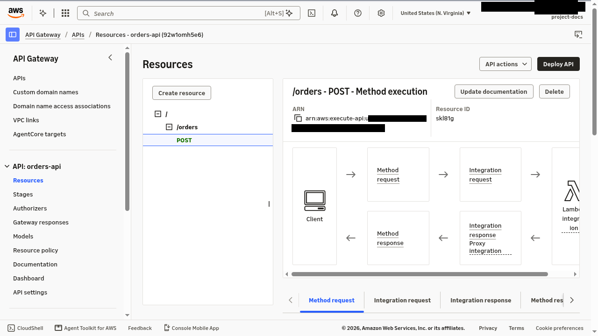

Method request: Authorization NONE, API key required True.

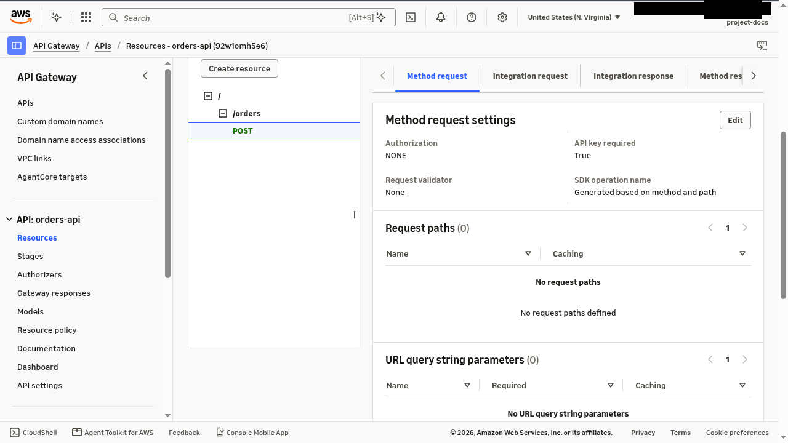

Integration request: Lambda proxy integration True, function `orders-intake`, timeout default (29 seconds).

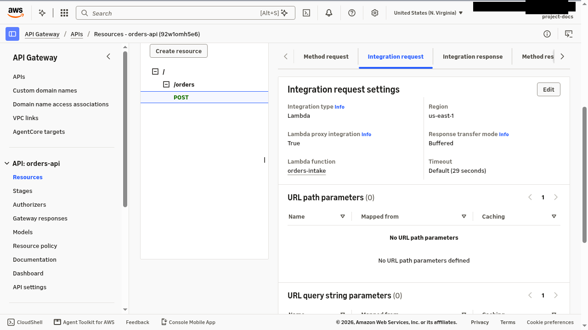

## 7. Stage `prod`

Stage `prod` of `orders-api`, active deployment `ccn4t8`, stage rate 10000 and burst 5000, cache cluster inactive.

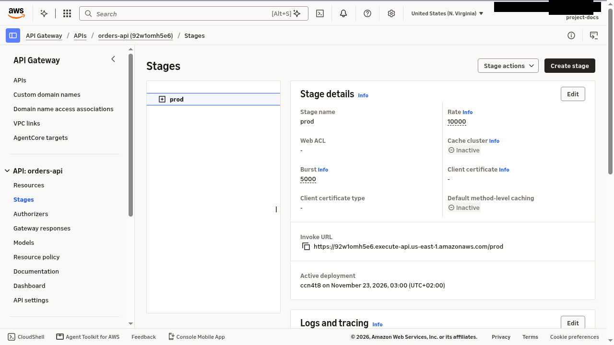

## 8. `OrdersQueue` and dead-letter queue

`OrdersQueue`: Standard, SSE-SQS, dead-letter queue enabled.

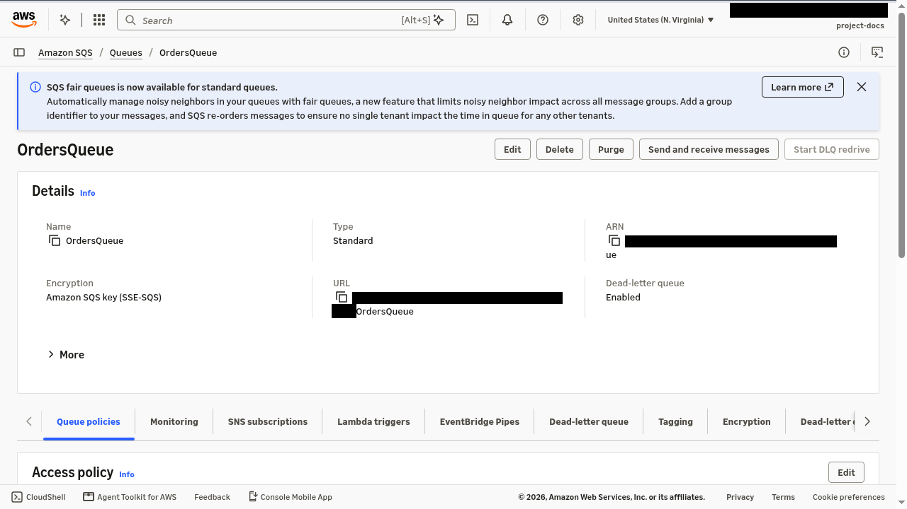

Dead-letter queue tab: target `OrdersDLQ`, maximum receives 5. No dead-letter delivery was tested.

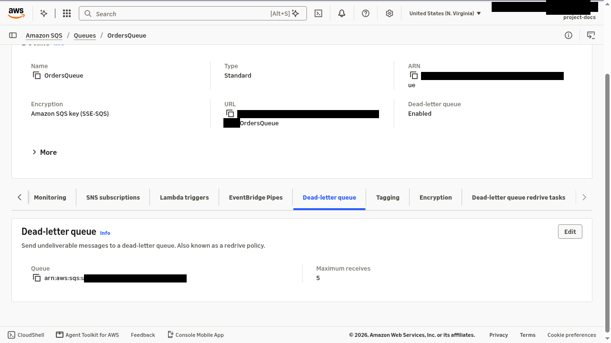

## 9. Queue to worker trigger

Lambda triggers tab of `OrdersQueue`: one trigger, function `orders-worker`, status Enabled, last modified 11/23/2026 2:51:26 AM.

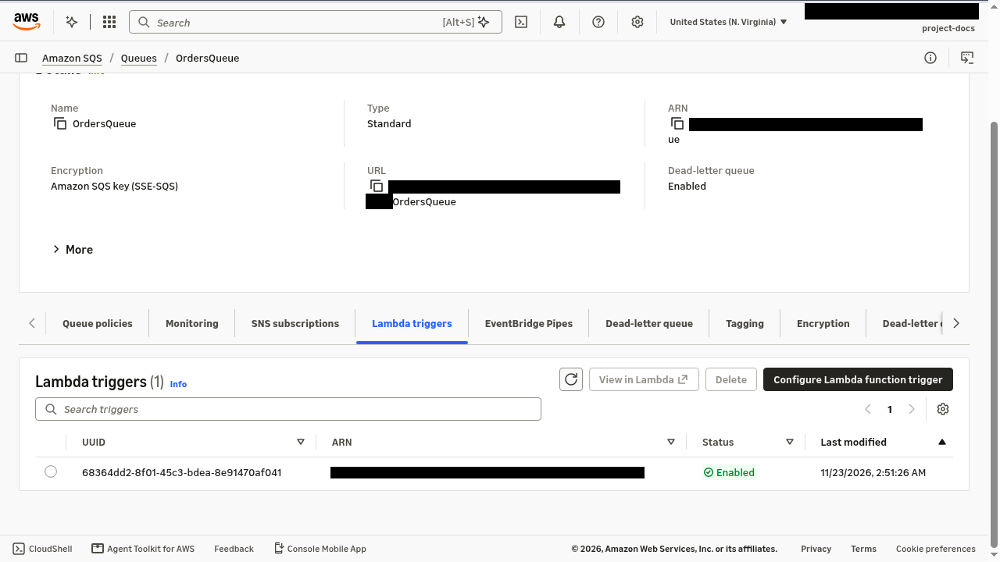

## 10. SNS alert topic and subscription

Standard topic `orders-alerts` and one email subscription with status Confirmed. The subscription was confirmed by the owner. No test notification was sent.

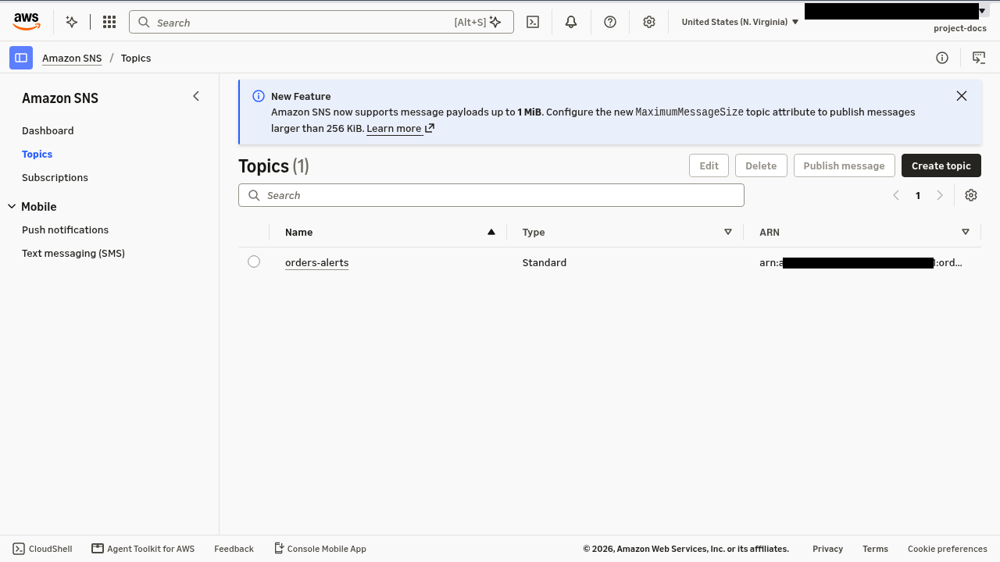

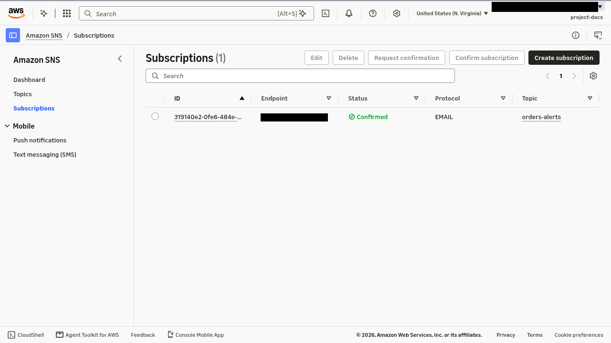

## 11. CloudWatch alarms

Five alarms, all in state OK with actions enabled, all publishing ALARM and OK transitions to `orders-alerts`: `orders-dlq-not-empty`, `orders-backlog-age`, `orders-backlog-depth`, `orders-worker-failures`, `orders-intake-errors`. They were created manually after the initial review, with the same thresholds as `template.yaml` (but without the stack-name prefix). They have not fired, and notification delivery has not been tested.

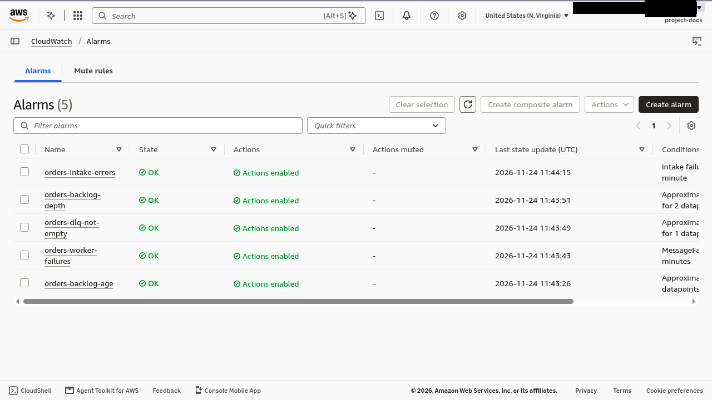

## 12. CloudWatch dashboard

Dashboard `orders`, nine widgets matching `template.yaml`: intake, queue depth, age of oldest message, worker outcomes, worker duration and concurrency, order wait, DLQ, API Gateway, and alarm status. Seven of the eight `FlashOrders` metrics exist; `OrdersRejectedAtIntake` has no data because no request has been rejected at intake yet. Sparse lines reflect low traffic.

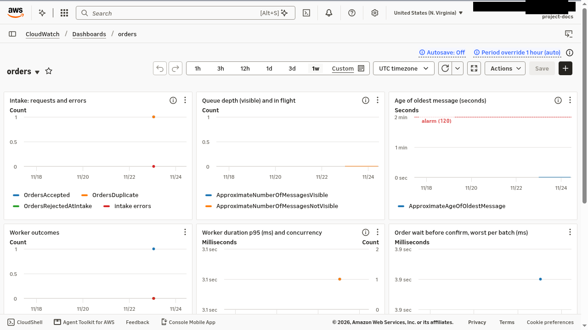

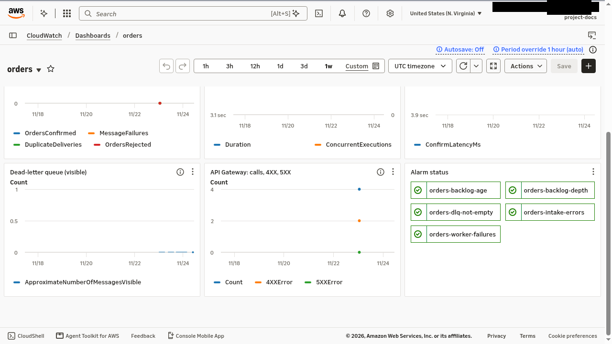

## Lambda code and configuration

The deployed code editor contents for `orders-intake` and `orders-worker` (`intake.py`, `worker.py`, `common.py`) were read from the console editor and compared with `src/` after normalizing trailing whitespace; they match. This is not a byte-level or hash comparison. Both functions: Python 3.12, arm64, 256 MB, no layers; intake timeout 10 s, worker timeout 15 s. Environment variable values were not read or recorded.
